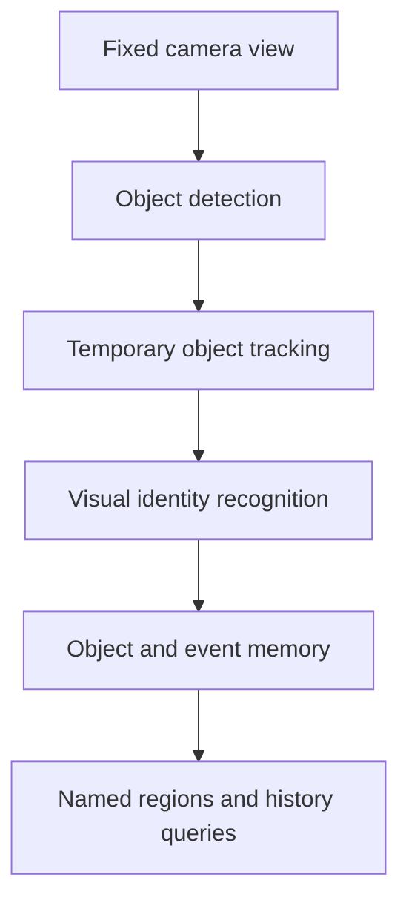

# How Project AUTO Works

[← Project overview](../README.md) · [Next: Identity and tracking →](02-identity-and-tracking.md)

Project AUTO explores a simple question: **can a camera-based system develop a useful memory of the physical objects in front of it?**

The prototype watches a fixed tabletop scene, detects and follows objects while they are visible, attempts to recognise previously observed items, and records meaningful changes in their presence and placement. Its memory can then be queried, rather than relying entirely on someone remembering where an object was put.

This document explains the public-facing system design. It intentionally does not include implementation code, matching formulas, internal configuration, or detailed model-coordination rules.

## The system at a glance

The stages have different jobs:

| Stage | Question it answers | Role in AUTO |
| --- | --- | --- |
| Camera input | What can the system see right now? | Provides observations of one fixed scene. |
| Detection | Where are recognisable objects in this image? | Locates candidate objects in camera frames. |
| Tracking | Which detections belong together while an object is visible? | Follows observations over a continuous period. |
| Identity recognition | Has this *physical item* been seen before? | Attempts to associate observations across separate encounters. |
| Persistent memory | What meaningful change happened, and where? | Retains identities and event history across application restarts. |
| Queries | What does the system currently believe, or what happened earlier? | Makes recorded object and region information accessible. |

A central distinction is that **seeing an object, tracking it, and remembering its identity are not the same task**. A detector may label two items as the same type of object; a tracker can follow one item for a short period; identity recognition attempts to connect separate sightings of the *same physical item*.

## A typical observation

Consider an illustrative example: someone places a mug on a desk, moves it to another area, takes it away, and later puts it back.

1. **Appearance:** The camera observes the mug. Detection and tracking establish a candidate observation.
2. **Identification:** AUTO attempts to decide whether the mug corresponds to a previously recorded physical item or represents a new one.
3. **Memory:** Once an identity is resolved, AUTO records a meaningful event, such as an item being added or recognised on return.
4. **Change:** A confirmed placement change can update the item's recorded location. An extended absence can produce a removal event.
5. **Query:** The development interface can look up a recorded item or inspect what has happened in a named area.

This is a conceptual walkthrough, **not a claim that every item or every transition will be recognised correctly**. Whether the system can follow an object depends on what the camera sees, what the detector finds, and the quality of the visual evidence.

## Why the system has a memory layer

A normal camera feed shows what is visible now. AUTO is intended to preserve selected information about **what was observed over time**.

The prototype stores object identities, selected visual references, and event-based history locally. It does **not** store a complete movement trajectory for every frame. This distinction matters: a useful last-observed placement can be recorded without treating every tiny movement in the video as a new event.

The memory persists across application restarts, while temporary tracking identifiers belong to individual tracking sessions.

## Local processing and interface

The prototype is a local Python application built around a consumer camera, an OpenCV development display, and SQLite storage. It uses established computer vision components:

- **YOLO11s** for object detection, with **BoT-SORT** for temporary tracking.
- **SAM2** to isolate object imagery from its surroundings.
- **DINOv2** to represent object appearance for recognition.
- **OpenVINO**, **PyTorch**, **OpenCV**, **SQLAlchemy**, and **SQLite** across inference, application logic, and persistence.

The computationally expensive recognition work is separated from the main detection-and-display path. This is an architectural approach to managing responsiveness, **not** a claim that the application runs at a guaranteed frame rate.

The current interface is a development-stage OpenCV display with terminal-based item and region queries. It is **not** a finished consumer search product.

## What this overview does not imply

The prototype is designed for **one stationary camera viewing a tabletop scene**. It does not infer calibrated 3D coordinates or fuse observations from several cameras. It does not have a production user interface, a natural-language assistant, or a guaranteed ability to distinguish visually identical items.

For the harder technical questions, continue to [Identity and Tracking](02-identity-and-tracking.md), [Spatial Memory](03-spatial-memory.md), and [Validation and Limitations](04-validation-and-limitations.md).
