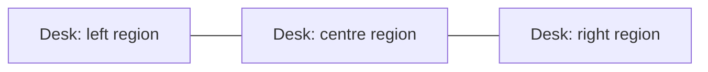
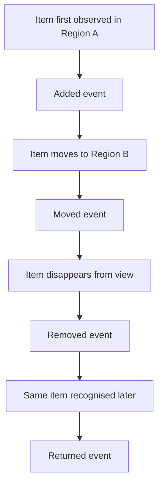

# Turning Observations into Spatial Memory

[← Project overview](../README.md) · [← Identity and tracking](02-identity-and-tracking.md) · [Next: Validation and limitations →](04-validation-and-limitations.md)

AUTO's goal is not simply to draw boxes around objects. It is to remember **meaningful changes in where objects were observed**.

That requires two things: a way to describe locations and a way to record changes over time.

## Locations are named regions

The prototype uses a **stationary camera** as its frame of reference. Areas such as “left side of desk” or “storage area” can be defined manually as regions in the camera image.

These regions are **two-dimensional image areas**, not real-world measurements. The system associates observed object positions with configured regions when recording events and answering queries.

For example, a tabletop demonstration might define:

*Illustrative example only; these are not predefined regions shipped with AUTO.*

Because the regions are tied to the camera image, moving the camera or changing its effective view can invalidate the spatial mapping. The current prototype does not automatically recalibrate it.

## What gets remembered

AUTO is **event-oriented**: it records significant changes, rather than saving every frame as a permanent location record.

| Recorded event | What it means |
| --- | --- |
| **Added** | A newly resolved item becomes part of the observed scene. |
| **Moved** | An identified item has completed a meaningful change in placement. |
| **Removed** | An identified item is no longer observed after the system's absence criteria are met. |
| **Returned** | An item previously marked removed is recognised again. |

For an illustrative sequence:

This history is useful because the latest image does not tell the whole story. An item may no longer be visible, yet the system can retain its earlier observations and region history.

## Current location versus historical location

This distinction matters for interpreting a query:

- **Current stored location** means the last recorded placement that the system currently associates with an item believed to be present.
- **Historical location** describes where the system recorded that item during an earlier event.
- **Removed** does not mean the system knows where the item physically went. It means it was no longer observed under the tracking rules. Its earlier placement remains part of its event history.

A missing item therefore cannot be promised a live, up-to-the-second location. AUTO can report *what it observed and recorded*, subject to the completeness and correctness of those observations.

## How information is accessed

The current development interface supports basic item and region lookups through terminal prompts. The available queries cover item location, current region contents, recent activity, and historical associations, with temporary on-screen region highlighting.

These are developer-oriented interactions. A polished visual search interface and natural-language questions are **not implemented in the documented prototype**.

## What makes spatial memory difficult

There is a difference between detecting motion and deciding that an item's *placement* has meaningfully changed. Slight movements in a bounding box do not necessarily mean someone relocated the item. Conversely, a real movement can be missed if identity has not yet been established or the object briefly disappears from view.

AUTO's event-memory design is meant to reduce the noise of frame-by-frame observations. But it is still an estimate based on a particular camera view, rather than a complete physical model of the room.

The exact timing rules, region-resolution calculations, database design, and event coordination are intentionally omitted from this public documentation.

For the evidence supporting the prototype and what remains unverified, read [Validation and Limitations](04-validation-and-limitations.md).
