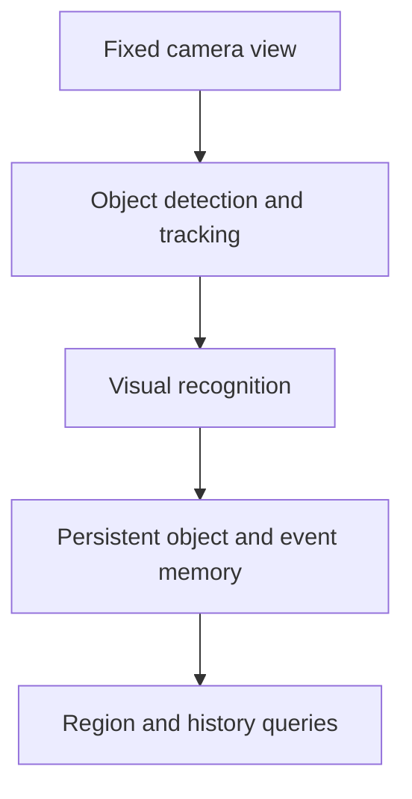

# project-auto
> Give your environment eyes 👀
>
> Project AUTO is a local computer vision prototype that observes a fixed camera view, tracks physical objects, and maintains a persistent record of what was seen and where. Its goal is simple: make it easier to answer “Where did I last put that?”
The idea
I've become known among friends and family for misplacing small things and then retracing my steps to find them. Eventually, that frustration turned into a question:

What if, instead of remembering where everything was myself, I could give my environment eyes—and a memory?

That question became Project AUTO. The name is a nod to AUTO, the autopilot from WALL-E: an overseer of its environment, though without the villainous ambitions.
What the prototype does
- Detects and tracks objects observed by a camera, including multiple objects in a cluttered scene.
- Attempts to recognise previously seen items when they appear again, rather than treating every new tracking session as a new physical object.
- Records meaningful changes when an item is added, moved, removed, or recognised on return.
- Associates items with named regions of a scene, defined using a fixed camera view.
- Keeps a persistent history of item identities, events, and recorded placements across application restarts.
- Supports basic location and region lookups through a development-stage console interface, including region contents and activity history.
The prototype was developed using an inexpensive consumer webcam and runs locally.
System overview

The core challenge is not detecting an object in a single frame. It's connecting observations over time: recognising a physical item after its appearance or position changes, while preserving a useful record of what happened to it.
Technologies used
Area	Technologies
Application and visualisation	Python, OpenCV
Object detection and tracking	YOLO11s, BoT-SORT
Object segmentation	SAM2
Visual recognition	DINOv2
Local persistent storage	SQLite, SQLAlchemy

These are established tools and models. The engineering work in AUTO centres on integrating them into a system that can maintain object identities and spatial event history over time.
Engineering challenges
Three questions shaped the project:
1. Identity: How can a system associate new observations with the same physical object, even when it looks different or returns after disappearing?
2. Time: How can it distinguish a meaningful placement change from ordinary frame-to-frame tracking movement?
3. Memory: How can observations become a persistent, queryable record rather than disappearing when the camera or application stops?
AUTO explores these problems in a single-camera setting, combining computer vision with event-based spatial memory.
Project status and limitations
Status: working research prototype, not a production-ready product.

The current implementation is designed around one stationary camera and a tabletop scene. Its regions are defined in the camera's two-dimensional image, not in measured 3D coordinates. The user-facing experience is still a debug display with console-based queries—not a finished search application.

Detection, tracking, identity handling, event persistence, and region queries are implemented. Earlier project testing reported successful object addition, re-identification, and return scenarios on real hardware. Automated tests also cover core lifecycle, memory, and region behaviour; the documented test run on 2 October 2026 recorded 281 passing tests.

Those results should not be interpreted as a measured recognition-accuracy rate or an end-to-end performance guarantee. Recognition calibration, comprehensive real-world evaluation, and production reliability remain open work. Difficult cases—including visually similar objects and occlusion—are not guaranteed to resolve correctly.
About this repository
This is the public showcase for Project AUTO. It explains the problem, the system's capabilities, and the engineering questions behind it. The development source code and detailed implementation architecture are not included here.
